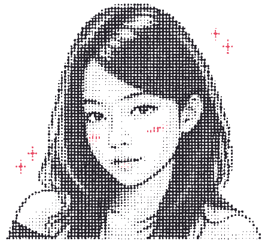

  <picture>
    <source media="(prefers-color-scheme: dark)" srcset="assets/portrait-dark.svg">
    <source media="(prefers-color-scheme: light)" srcset="assets/portrait-light.svg">
    
  </picture>
  <h2>Hi, I'm Nausicaä.</h2>
  
Thi-Hong-Cuc Le

  

    <a href="https://nausmind.com/">🔗 Website</a> ·
    <a href="https://scholar.google.com/citations?user=C4zRCk0AAAAJ&amp;hl=en">🎓 Scholar</a> ·
    <a href="https://orcid.org/0009-0003-4251-4106">🆔 ORCID</a> ·
    <a href="https://www.linkedin.com/in/lthc9/">💼 LinkedIn</a>
  

<h2>👋 About Me</h2>

I'm Thi-Hong-Cuc Le, also known as Nausicaä, a researcher and software engineer based in Vietnam. I'm currently pursuing an M.Sc. in Computer Science at HCMUT.

My research focuses on trustworthy and efficient AI, with a particular interest in understanding, evaluating, and improving the reliability of intelligent systems.

<ul>
  <li>Research Engineer at RAISE Lab, HCMUT.</li>
  <li>Senior Research Assistant at URA Research Group, HCMUT.</li>
  <li>Software Engineer at Bosch Global Software Technologies.</li>
</ul>

<h2>🔬 Research Interests</h2>
<ul>
  <li><strong>Trustworthy &amp; Explainable AI</strong> — Model reliability, robustness, interpretability, and AI assurance.</li>
  <li><strong>Efficient AI</strong> — Model compression, post-training quantization, mixed-precision inference, and on-device deployment.</li>
  <li><strong>LLMs &amp; Intelligent Agents</strong> — Retrieval-augmented generation, information retrieval, and agent reliability.</li>
  <li><strong>AI for Software Engineering</strong> — Software security, repository-level reasoning, and empirical evaluation.</li>
  <li><strong>AI for Scientific Discovery</strong> — Physics-informed learning and intelligent engineering design.</li>
</ul>

<h2>📚 Research Highlights</h2>
<table>
  <thead><tr><th>Venue</th><th>Research</th><th>Recognition</th></tr></thead>
  <tbody>
    <tr><td><strong>ASE 2026</strong> CORE A*</td><td><strong>GraphLedger</strong> Repository-level vulnerability detection via graph-based compression and assumption validation.</td><td>First Author</td></tr>
    <tr><td><strong>ICDM 2026</strong> CORE A*</td><td><strong>LTM-RAG</strong> Longitudinal trust mining for poison-resilient retrieval-augmented generation.</td><td>First Author · Oral Presentation</td></tr>
    <tr><td><strong>IEA/AIE 2026</strong></td><td><strong>From Black-Box to Glass-Box</strong> Explainable AI for applied intelligent software systems.</td><td>🏆 Best Paper Award</td></tr>
  </tbody>
</table>

Explore my publications on <a href="https://scholar.google.com/citations?user=C4zRCk0AAAAJ&amp;hl=en">Google Scholar</a>.

<h2>💼 Experience</h2>
<table>
  <thead><tr><th>Organization</th><th>Role</th><th>Period</th></tr></thead>
  <tbody>
    <tr><td><strong>Bosch Global Software Technologies</strong></td><td>Software Engineer — Data Analytics, Frontend &amp; AI/ML</td><td>2022 – Present</td></tr>
    <tr><td><strong>RAISE Lab · HCMUT</strong></td><td>Research Engineer</td><td>2026 – Present</td></tr>
    <tr><td><strong>URA Research Group · HCMUT</strong></td><td>Senior Research Assistant</td><td>2026 – Present</td></tr>
  </tbody>
</table>

<h2>🎓 Education</h2>
<ul>
  <li><strong>M.Sc. in Computer Science</strong> Ho Chi Minh City University of Technology (HCMUT) 2025 – Present</li>
  <li><strong>B.Eng. in Information Systems</strong> University of Information Technology (UIT), VNU-HCM 2019 – 2024</li>
</ul>

<h2>🛠️ Tech Stack</h2>

  <h4>Programming Languages</h4>
  

    
    
    
    
  

  <h4>AI &amp; Machine Learning</h4>
  

    
    
    
    
    
    
  

  <h4>Software Engineering</h4>
  

    
    
    
    
    
  

  <h4>Research &amp; Development Tools</h4>
  

    
    
    
    
    
    
  

<h2>📈 Contribution Activity</h2>

  <picture>
    <source media="(prefers-color-scheme: dark)" srcset="https://github-readme-activity-graph.vercel.app/graph?username=nausicaa2701&amp;bg_color=0d1117&amp;color=f0a6bc&amp;line=f0a6bc&amp;point=ffffff&amp;hide_border=true&amp;area=true&amp;area_color=f0a6bc">
    <source media="(prefers-color-scheme: light)" srcset="https://github-readme-activity-graph.vercel.app/graph?username=nausicaa2701&amp;bg_color=ffffff&amp;color=9d4563&amp;line=d47898&amp;point=9d4563&amp;hide_border=true&amp;area=true&amp;area_color=f0a6bc">
    
  </picture>

<h2>🌿 Off the Clock</h2>

Beyond research and engineering, I enjoy exploring new places, discovering different cultures, capturing little moments, and learning something new every day.

  <i>A little courage, a curious heart, and a whole world to explore.</i> 🍀

  

